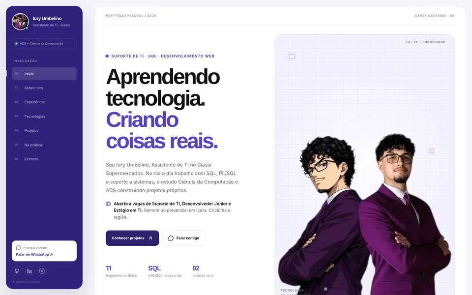

# Iury Umbelino — Portfólio

Portfólio pessoal de Iury Umbelino, Assistente de TI no Giassi Supermercados e estudante de Ciência da Computação (UNESC) e ADS (UNOPAR). O site apresenta a experiência profissional, as tecnologias que uso e estudo e os projetos que já estão no ar.

**No ar:** https://umbelino.vercel.app



## Stack

- [TanStack Start](https://tanstack.com/start) — React 19 com renderização no servidor (SSR)
- [TanStack Router](https://tanstack.com/router) — rotas por arquivo em `src/routes`
- TypeScript
- Tailwind CSS v4 + CSS próprio em `src/styles.css`
- Vite + Nitro (build), deploy na Vercel

## Estrutura

| Caminho | O que tem |
| --- | --- |
| `src/data/portfolio.ts` | Todo o conteúdo: navegação, contatos, experiência, formação, tecnologias, projetos e áreas práticas |
| `src/components/portfolio/Sections.tsx` | Hero, Sobre mim, Experiência, Tecnologias, Projetos, Na prática e a faixa da SOU Studio |
| `src/components/portfolio/Sidebar.tsx` | Sidebar fixa e menu mobile |
| `src/components/portfolio/ContactSection.tsx` | Contato e rodapé |
| `src/routes/__root.tsx` | Metadados genéricos, fontes, 404 e página de erro |
| `src/routes/index.tsx` | Metadados da home (Open Graph, canonical) e ordem das seções |
| `public/` | Imagens (WebP), favicons, `og-image.png`, `robots.txt` e `sitemap.xml` |

## Decisões principais

- **Conteúdo em um só arquivo.** Textos, links e contatos ficam em `src/data/portfolio.ts`; os componentes só renderizam. Trocar um texto ou o WhatsApp é uma edição em um lugar.
- **Numeração derivada da navegação.** O número de cada seção vem da posição em `navItems`, então a sidebar e os títulos das seções nunca ficam diferentes.
- **Imagens leves.** Fotos em WebP no tamanho em que aparecem, com `width` e `height` para evitar saltos de layout. As imagens da home somam menos de 100 KB.
- **Acessibilidade.** Texto com contraste mínimo de 4,5:1, tamanho mínimo de 12 px para texto informativo, alvos de toque com 40 px e animação de entrada desligada com `prefers-reduced-motion`.
- **Sem dependências sobrando.** O kit de componentes que veio com o template foi removido; o site usa apenas React, TanStack, Tailwind e `lucide-react`.

## Desenvolvimento local

Requer Node.js 20+.

```sh
npm install
npm run dev
```

O site sobe em `http://localhost:8080`.

## Verificações

```sh
npx tsc --noEmit
npm run lint
npm run build
```

## Deploy

Build automático na [Vercel](https://vercel.com) a cada push na branch `main`.
